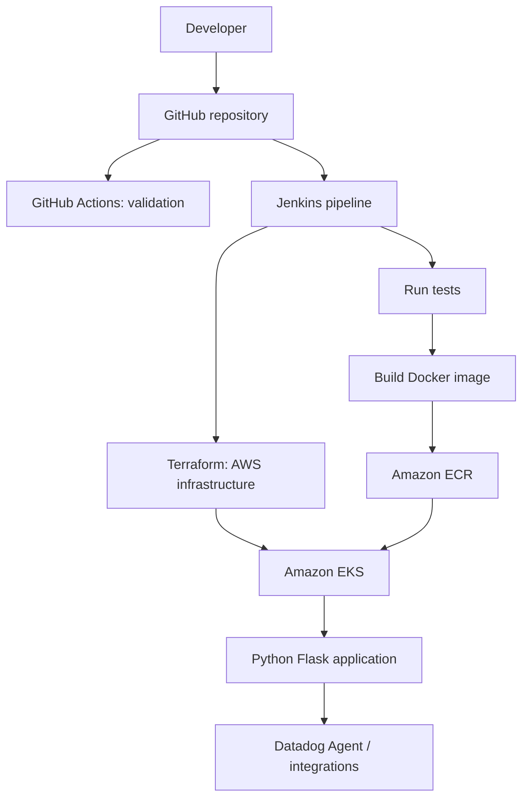

# Cloud-Native DevOps Platform on AWS

A portfolio project demonstrating a small Python web application, containerization with Docker, Kubernetes deployment manifests, Terraform infrastructure examples, Jenkins CI/CD, GitHub Actions validation, and Datadog monitoring guidance.

> **Implementation status:** This repository contains source code and configuration examples. It has not been deployed to AWS or connected to Jenkins/Datadog by this package. Complete the setup and validation steps before describing a live deployment in an interview. No screenshots or deployment results are fabricated.

## Goals

- Package a small HTTP application into a container.
- Test application behavior automatically.
- Describe a repeatable CI/CD flow.
- Keep infrastructure and deployment configuration version-controlled.
- Document monitoring, security, costs, and troubleshooting.

## Architecture



The Terraform example in this repository creates an ECR repository only. EKS cluster provisioning is deliberately left as a documented next step: EKS introduces ongoing costs and a complete cluster requires additional networking, IAM, and access configuration. The Kubernetes manifests can first be tested with a local cluster such as kind or Minikube.

## Technology stack

| Technology | Purpose in this repository |
|---|---|
| Python + Flask | Small sample HTTP service and health endpoint |
| pytest | Automated application tests |
| Docker | Reproducible container image |
| Kubernetes | Deployment and service manifests |
| Terraform | Example AWS ECR infrastructure |
| Jenkins | CI/CD pipeline template |
| GitHub Actions | Pull request validation |
| Datadog | Monitoring setup guide |
| Linux / shell | Local automation scripts |

## Repository layout

```text
cloud-native-devops-platform/
├── app/                         # Flask app and tests
├── docker/Dockerfile             # Container build
├── k8s/                          # Kubernetes manifests
├── terraform/                    # Terraform ECR example
├── jenkins/Jenkinsfile            # CI/CD pipeline template
├── .github/workflows/ci.yml       # Repository checks
├── monitoring/                    # Datadog setup notes
├── scripts/                       # Local helper scripts
└── docs/                          # Architecture, setup, deployment, interviews
```

## Prerequisites

For local work: Git, Python 3.11+, pip, and Docker. For Kubernetes: kind or Minikube plus `kubectl`. Terraform and AWS CLI are required only for the AWS example. Jenkins and Datadog require separately configured services/accounts.

## Run locally

From the repository root:

```bash
python -m venv .venv
# Linux/macOS:
source .venv/bin/activate
# Windows PowerShell:
# .venv\Scripts\Activate.ps1

pip install -r app/requirements.txt
pip install -r app/requirements-dev.txt
pytest -q app/tests
python app/app.py
```

Open `http://127.0.0.1:5000/` and `http://127.0.0.1:5000/health`. Stop the server with `Ctrl+C`.

## Build and run with Docker

```bash
docker build -f docker/Dockerfile -t cloud-native-devops-platform:local .
docker run --rm -p 5000:5000 cloud-native-devops-platform:local
```

Test `http://127.0.0.1:5000/health`. Stop with `Ctrl+C`.

## Kubernetes (local cluster first)

The manifest image is a placeholder. Build and load the image into your local cluster before applying the manifests. For kind:

```bash
kind create cluster --name devops-demo
docker build -f docker/Dockerfile -t cloud-native-devops-platform:local .
kind load docker-image cloud-native-devops-platform:local --name devops-demo
```

Edit `k8s/deployment.yaml` so `image` is `cloud-native-devops-platform:local` and `imagePullPolicy` is `IfNotPresent`, then run:

```bash
kubectl apply -f k8s/namespace.yaml
kubectl apply -f k8s/configmap.yaml
kubectl apply -f k8s/service.yaml
kubectl apply -f k8s/deployment.yaml
kubectl -n devops-demo get all
kubectl -n devops-demo port-forward service/devops-demo-service 8080:80
```

Open `http://127.0.0.1:8080/health`. Cleanup:

```bash
kubectl delete -f k8s/
kind delete cluster --name devops-demo
```

For remote ECR images, configure image publishing and cluster pull access before deploying. Do not commit credentials.

## Terraform (AWS ECR example)

This configuration creates an ECR repository; it does **not** create EKS, VPC networking, or Jenkins. Review cost and permissions before applying.

```bash
cd terraform
cp terraform.tfvars.example terraform.tfvars
terraform fmt -recursive
terraform init
terraform validate
terraform plan
terraform apply
```

Authenticate the AWS CLI using a profile or role; do not put access keys in `.tf` or `.tfvars` files. After creating the repository, use the ECR URI from Terraform output when tagging and pushing images. To remove the example resource:

```bash
terraform destroy
```

Terraform state may contain infrastructure metadata. Keep local state files out of Git; for team use, configure an encrypted, access-controlled remote backend with locking appropriate to your Terraform version.

## Jenkins

The `jenkins/Jenkinsfile` is a pipeline template. It assumes a Jenkins agent with Python, Docker, AWS CLI, and kubectl available, plus credentials/role permissions configured outside source control. The pipeline runs tests and builds an image on every build. Publishing/deployment is conditional on environment configuration and the `main` branch. Read `docs/deployment-guide.md` before enabling deployment.

## GitHub Actions

The workflow runs application tests and Terraform formatting/validation on pushes and pull requests. It does not provision AWS resources or publish images.

## Datadog

See [`monitoring/datadog-configuration.md`](monitoring/datadog-configuration.md). A real Datadog account, secure API key configuration, and Agent/integration deployment are required for live telemetry. This repository does not include screenshots or claim that dashboards are already live.

## Security notes

- Never commit AWS keys, Datadog keys, Jenkins credentials, kubeconfig files, `.tfstate`, or secret manifests.
- Prefer IAM roles/OIDC over long-lived access keys where supported.
- Restrict IAM and Kubernetes permissions to the actions needed.
- Keep cluster API access private/restricted where possible.
- Review dependencies and container images before using this pattern outside a learning environment.

## Cost notes

AWS ECR storage and data transfer may incur charges. EKS has cluster and supporting-resource costs, even for small demos. Set a budget alert, check the current AWS pricing page, and destroy resources after testing. Local kind/Minikube is the lower-cost starting point.

## Known limitations / status

- App source, tests, Dockerfile, Kubernetes manifests, Terraform ECR example, and pipeline templates are included.
- AWS deployment, EKS provisioning, Jenkins credentials, ECR publishing, and Datadog telemetry require your own setup and validation.
- No performance numbers, uptime claims, screenshots, or successful deployment claims are included.
- The Jenkins deploy stage is opt-in and requires an already available Kubernetes context.

## Suggested next steps

1. Run the tests locally.
2. Build and run the Docker image.
3. Deploy to kind/Minikube.
4. Validate Terraform formatting and plan; only apply when ready to incur AWS costs.
5. Configure Jenkins credentials and test the pipeline in a disposable environment.
6. Set up Datadog only after the application is running.
7. Update this README with only results you personally verified.

## Resume wording

After completing and verifying the implementation, adapt the resume bullet to match what you actually did. Until then, describe it as a **DevOps portfolio project** rather than a completed production deployment.
